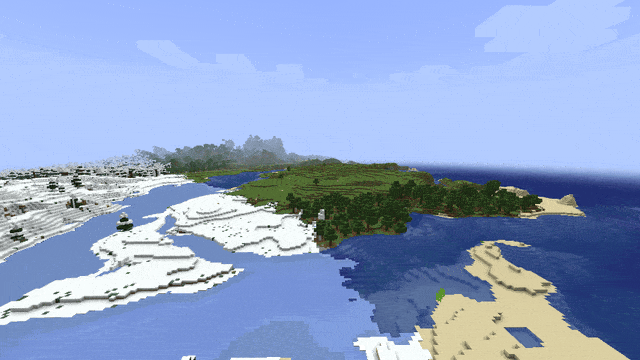

> ⚠️ **Disclaimer: This project is AI-generated.** The code, this description and the icon of this mod were created with generative AI (Claude by Anthropic), directed by me. While I am a professional software developer, I am not a Java developer, so I use generative AI to build mods that my friends and I want to play with, and I like to share the ones that work well with everyone. I understand if you do not want to support the use of generative AI, which is why I put this disclaimer here. If you run into any problems, please report them on GitHub.

# Player Render Distance

See the other players on your server far beyond the view distance: across the valley, on the next mountain, hundreds of blocks away.

## Features

- In vanilla, the server only sends you the players within its view distance, and your client only draws them up to 64 blocks and only where chunks are loaded. With this mod the **server** sends you the players within **1024 blocks** (configurable), and your **client** draws them there, **even where no chunks are loaded**.
- The **fog** at the edge of your render distance would still hide them, so players further away than half your render distance are drawn closer to you and smaller: on screen they look exactly the same, just without the fog. Terrain in the outer half of the render distance does not hide them.
- Works with **Distant Horizons**: the other players stand on its far terrain instead of floating above the void, and its fade into the far terrain does not hide them either.
- Pairs well with a **zoom** mod, since at 500 blocks a player is only a few pixels tall.
- Only players are affected, no other entities. Spectators and invisible players stay hidden like in vanilla, and names are shown up to 64 blocks like in vanilla.

## Installation

Install the mod on the **server and the client** for the full effect. No other mods are required. Either side works alone: without the mod on the client, players just do not see the far players; without it on the server, players are only drawn within the server's view distance, but there beyond the entity distance and the fog. Players without the mod can join a server with it and vice versa.

## Configuration

`config/playerrenderdistance.properties` is created on first start and reloaded automatically when it changes. It can also be edited in game: on NeoForge in *Mods → Player Render Distance → Config*, on Fabric through [Mod Menu](https://www.curseforge.com/minecraft/mc-mods/modmenu). Invalid values are marked red and cannot be saved, and every value can be reset to its default.

The server decides how far away players are sent (`trackingRange`), the client how far away they are drawn (`renderRange`). Both default to 1024 blocks; 0 restores vanilla behavior. On servers with many players, a lower tracking range saves bandwidth.

## Versions

Available for **Fabric** and **NeoForge** on Minecraft **1.21 – 26.3**. Download the file that matches your loader and Minecraft version.

## Links

- [Source code](https://github.com/welles/minecraft-player-render-distance)
- [Report a problem](https://github.com/welles/minecraft-player-render-distance/issues)
- [Changelog](https://github.com/welles/minecraft-player-render-distance/blob/main/CHANGELOG.md)
