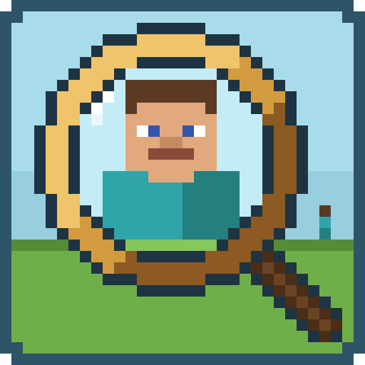
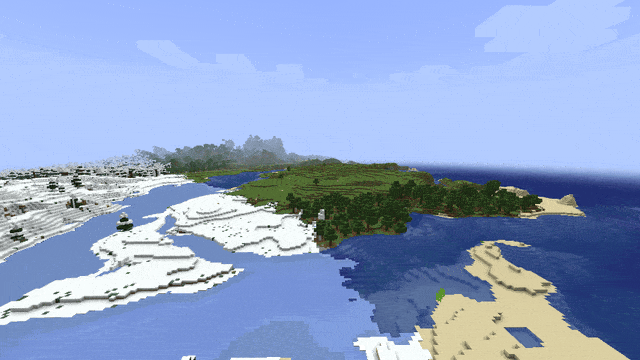

# Player Render Distance

A Minecraft mod for **Fabric** and **NeoForge** (Minecraft 1.21.1 – 26.3) for small multiplayer servers: you see the
**other players far beyond the view distance**, hundreds of blocks away, even where your client has no chunks loaded.



In vanilla, the server only sends you the players within its view distance, and your client only draws them up to
the entity distance from the video settings (64 blocks at 100%) and only where chunks are loaded. Fog hides them even
before that. With this mod:

- The **server** sends every player the other players in the same dimension within the **tracking range**
  (1024 blocks by default), whether the chunks there are loaded for that player or not.
- The **client** draws the other players within the **render range** (1024 blocks by default), beyond the entity
  distance and also where no chunks are loaded. Without terrain there they float above the void, with
  [Distant Horizons](https://modrinth.com/mod/distanthorizons) they stand on its far terrain.
- Towards the edge of the render distance, the fog (or Distant Horizons' fade into its far terrain) would make them
  invisible. Players further away than **half the render distance** are therefore drawn closer to you and smaller by
  the same factor: on screen they look exactly the same, just without the fog. The catch is that terrain in the outer
  half of the render distance no longer hides them.
- A **zoom** mod is the natural companion: at 500 blocks a player is only a few pixels tall.
- Only players are affected, no other entities. Spectators and invisible players stay hidden like in vanilla, and
  names are shown up to 64 blocks like in vanilla.

Tested with Distant Horizons 3.3.4 and Ok Zoomer 19 on Minecraft 26.3.

## Installation

The mod is needed on the **server and the client** for the full effect. Either side works alone and without the mod
on the other side, players without it can join servers with it and vice versa:

- **Server only:** players without the mod receive the far players, but their client does not draw them.
- **Client only:** the server only sends players within its view distance; within that, they are drawn beyond the
  entity distance and the fog.

Singleplayer worlds opened to LAN run the server side as well.

Every player that is sent to another one sends it a few small movement updates per second. On a small server this is
negligible; on a server with many players, lower the tracking range.

## Configuration

`config/playerrenderdistance.properties` is created on first start. Changes are applied automatically while the game
is running. It can also be edited in game: on NeoForge in *Mods → Player Render Distance → Config*, on Fabric through
[Mod Menu](https://modrinth.com/mod/modmenu). Invalid values are marked red and cannot be saved; every value can be
reset to its default.

| Key             | Default | Description                                                                                                                                                       |
|-----------------|---------|-------------------------------------------------------------------------------------------------------------------------------------------------------------------|
| `trackingRange` | `1024`  | Server: other players within this many blocks (horizontally, same dimension) are sent to every player, also beyond the view distance. `0` = vanilla. `0` to `100000`. |
| `renderRange`   | `1024`  | Client: other players within this many blocks are drawn, also outside the loaded chunks and beyond the entity distance. `0` = vanilla. `0` to `100000`.            |

## Building

The project uses [Stonecutter](https://stonecutter.kikugie.dev/) to build every Minecraft version and loader from one
source tree. Each node in `settings.gradle.kts` targets one Minecraft version and declares the compatible range in
`stonecutter.properties.toml`.

```sh
./gradlew build                          # build all versions and loaders
./gradlew buildAndCollect                # copy all jars to build/libs/<mod version>/
./gradlew :1.21.1-fabric:runClient       # run a specific version (Fabric)
./gradlew :26.3-neoforge:runClient       # run a specific version (NeoForge)
```

To try the mod in multiplayer, start a local server and two clients (Alice and Bob) that join it automatically:

```sh
scripts/test-multiplayer.sh                  # 1.21.11-fabric
scripts/test-multiplayer.sh 26.3-neoforge    # any other node
```

The test server runs in offline mode, creative on a flat world, with a view distance of 4 chunks: fly more than 64
blocks away and the other player is only still there thanks to the mod. Other mods for a client, such as Distant
Horizons or a zoom mod, go into `run/test/Alice/mods` or `run/test/Bob/mods`. Stop everything with Ctrl+C.

Every push to `main` builds all versions on GitHub Actions; the jars can be downloaded from the run's artifacts.

On **NixOS**, run the game inside the provided Nix shell so Minecraft finds its native libraries
(otherwise it crashes with `GLFW error during init: Failed to detect any supported platform`):

```sh
nix-shell --run './gradlew :1.21.1-fabric:runClient'
nix-shell --run scripts/test-multiplayer.sh
```

Version-specific code uses Stonecutter comments (`//? if >=1.21.9 {`). The source tree is checked in for the
`1.21.1-fabric` node; switch the active version with the `Set active project to …` Gradle tasks before editing code
for another version, and switch back to `1.21.1-fabric` (`Reset active project`) before committing.

## License

[MIT](LICENSE)
